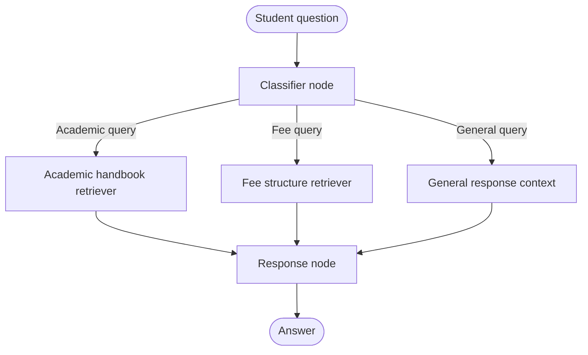

# Agentic AI Learnings 🤖

A hands-on repository documenting my work with **Agentic AI, LangGraph, and LLM-powered workflows**. This repo focuses on turning core concepts into runnable Python examples—from stateful graphs and tool loops to conditional RAG and human-in-the-loop flows.

> Learn by building: small, focused implementations that make agent architecture easier to understand and extend.

## What's inside

| File | Focus |
|---|---|
| `states.py` | Working with graph state and state updates |
| `sequential_base.py` | Sequential workflow patterns |
| `parallel_reducers.py` | Parallel execution and combining state updates with reducers |
| `iterative_tools.py` | Iterative tool-use workflows |
| `humanintheloop.py` | Human-in-the-loop patterns for review or approval |
| `conditional_RAG.py` | Conditional retrieval-augmented generation |
| `app.py` | Streamlit college assistant using LangGraph and document-based RAG |
| `requirements.txt` | Python dependencies |

The repository also currently includes two PDF knowledge sources used by the college assistant: `academics_handbook.pdf` and `fee_structure.pdf`.

## Concepts explored

- **State:** shared data carried across graph execution.
- **Nodes:** Python functions that carry out individual steps, such as classification, retrieval, or response generation.
- **Edges:** transitions between steps; conditional edges route execution based on state.
- **Graphs:** the orchestration layer that connects nodes and edges into a workflow.
- **RAG:** retrieving relevant document chunks and grounding an LLM response in that context.
- **Tool use and control flow:** iterative execution, parallel work, and human review.

## Featured implementation: College Assistant 🎓

The Streamlit app uses LangGraph to route student questions to the relevant workflow:



### How it works

1. **Classify:** an LLM classifies the question as academic, fee-related, or general.
2. **Route:** a conditional edge selects the appropriate path.
3. **Retrieve:** academic and fee questions retrieve relevant chunks from the corresponding PDF using embeddings and FAISS. General questions skip retrieval.
4. **Respond:** the LLM generates an answer using the retrieved context when available and the student's programme as additional context.

### Stack

- **Orchestration:** LangGraph, LangChain
- **LLM:** Groq via `ChatGroq` (Llama 3.3 70B Versatile in the current implementation)
- **Retrieval:** Hugging Face sentence-transformer embeddings, FAISS
- **Document processing:** PyPDF, RecursiveCharacterTextSplitter
- **Interface:** Streamlit
- **Configuration:** python-dotenv

## Getting started

### 1. Clone the repository

```bash
git clone https://github.com/RiyanshiTomar/Agentic_AI_Learnings.git
cd Agentic_AI_Learnings
```

### 2. Create and activate a virtual environment

**Windows PowerShell**
```powershell
python -m venv venv
.\venv\Scripts\Activate.ps1
```

**macOS / Linux**
```bash
python -m venv venv
source venv/bin/activate
```

### 3. Install dependencies

```bash
python -m pip install --upgrade pip
pip install -r requirements.txt
```

### 4. Configure your environment

Create a `.env` file in the project root and add your Groq API key:

```env
GROQ_API_KEY=your_groq_api_key_here
```

Get a key from [Groq Console](https://console.groq.com/). Keep real credentials private—**never commit your `.env` file or paste API keys into source code**.

### 5. Run the Streamlit app

Make sure `academics_handbook.pdf` and `fee_structure.pdf` are present in the project root, then run:

```bash
streamlit run app.py
```

The first startup may take longer because the embedding model and document indexes need to load.

## Run individual examples

Run any script from the project root with the same environment activated. For example:

```bash
python states.py
python sequential_base.py
python parallel_reducers.py
python iterative_tools.py
python humanintheloop.py
python conditional_RAG.py
```

Some examples may need API credentials or configuration specific to the model/provider they use. Check each script before running it.

## Project structure

```text
Agentic_AI_Learnings/
├── app.py
├── states.py
├── sequential_base.py
├── parallel_reducers.py
├── iterative_tools.py
├── humanintheloop.py
├── conditional_RAG.py
├── requirements.txt
├── academics_handbook.pdf
├── fee_structure.pdf
├── .env                 # local only; do not commit
└── venv/                # local only; do not commit
```

## Roadmap 🧭

This repository will grow as I explore and implement more AI Engineering concepts, including:

- Agent routing, tool calling, and memory
- RAG patterns and retrieval quality
- Guardrails and structured outputs
- Context windows and tokenization
- Evaluation, deployment, and production-oriented practices

## Learning resources

- [LangGraph documentation](https://docs.langchain.com/oss/python/langgraph/overview)
- [LangChain documentation](https://python.langchain.com/docs/introduction/)
- [Groq Console](https://console.groq.com/)

## Contributing & feedback

Suggestions, issues, and discussions are welcome. If you find an example useful or spot a way to improve it, feel free to open an issue or pull request.

---

**Built while learning and experimenting with Agentic AI.**  
⭐ If this repository helps you, consider giving it a star!
